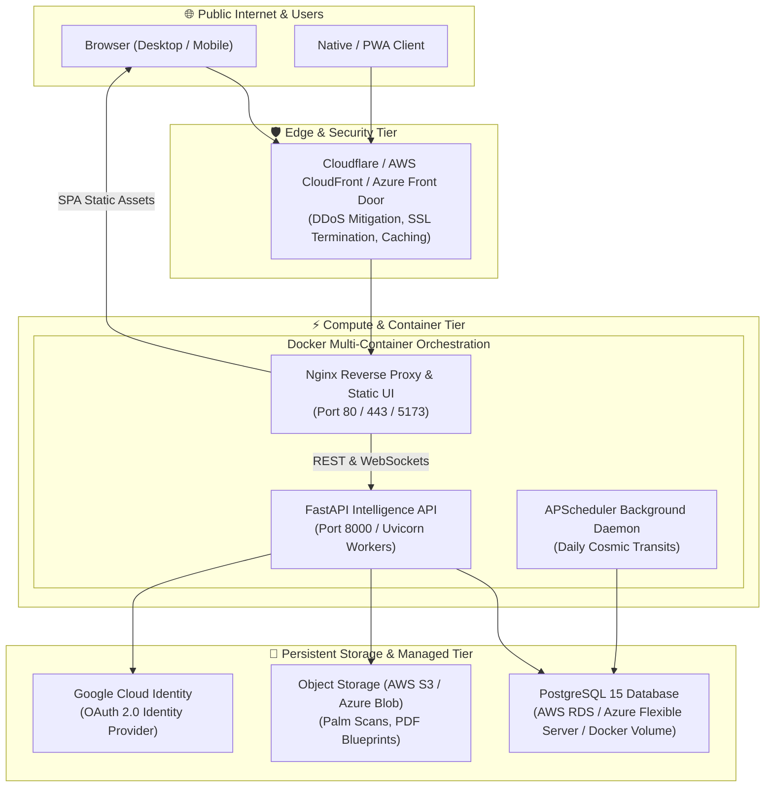
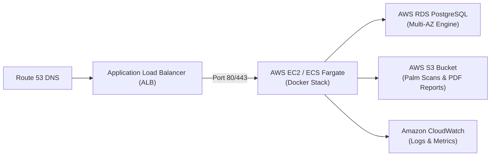
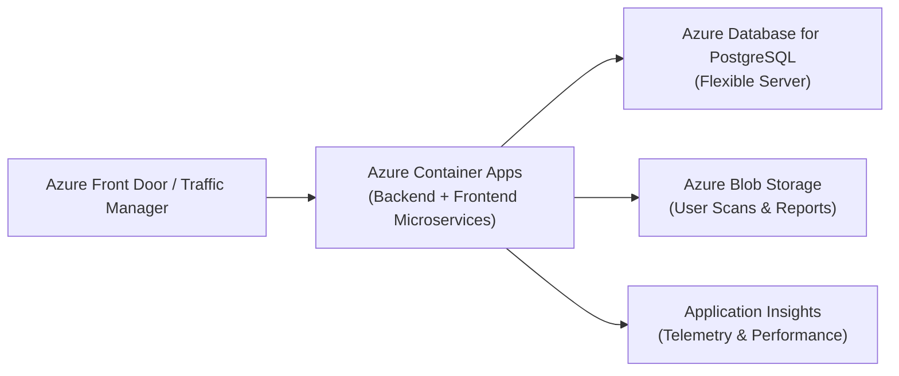
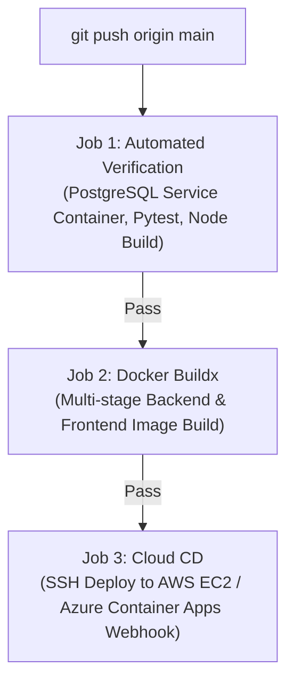

# ☁️ Cloud & DevOps Architecture Guide: Docker, AWS & Azure

This comprehensive guide details the **production-grade Cloud and DevOps deployment strategies** for the **Mystic Insights Platform** (Infosys Capstone Specification).

---

## 🏛️ 1. Multi-Cloud & Container Architecture Overview



---

## 🐳 2. Containerization with Docker

The application is engineered into **lightweight, isolated, multi-stage microservices**:

### Service Breakdown

| Container | Base Image | Role | Production Port | Health Check |
| :--- | :--- | :--- | :---: | :--- |
| **`mystic_frontend_ui`** | `nginx:alpine` (Built via `node:22-alpine`) | Serves minified React Vite bundle, handles SPA routing, reverse-proxies API requests. | `80` / `5173` | Nginx worker liveness |
| **`mystic_backend_api`** | `python:3.9-slim` | Executes FastAPI, MediaPipe AI Palm Vision, Swiss Ephemeris calculations, JWT Auth, and PDF generation. | `8000` | HTTP `GET /auth/google/status` |
| **`mystic_postgres_db`** | `postgres:15-alpine` | Relational storage for user profiles, reading history, consultation bookings, and RBAC roles. | `5432` | `pg_isready -U postgres` |

### Key Docker Optimizations Implemented:
1. **Multi-Stage Node 22 Build**: Compiles TypeScript/JSX using Vite 8 and Rolldown in Stage 1 (~2.5s), copying only production static artifacts into Stage 2 Alpine Nginx. Final image size: **< 98 MB**.
2. **Lean Python 3.9 Debian Slim**: Stripped out non-essential compilation toolchains (`build-essential`) and llvm binaries; pinned pre-compiled wheels for `opencv-contrib-python` and `mediapipe`. Final image size: **< 1.25 GB** (including TensorFlow & vision models).
3. **Internal Bridge Network**: Backend and Database communicate over an internal private Docker network (`mystic_internal`). Database port is protected from arbitrary external exposure.
4. **Persistent Volumes**: Named volume `postgres_data` guarantees zero data loss across container teardowns or upgrades.

### Single-Command Local/DevOps Launch
```bash
# Build and run all services in background
docker compose up --build -d

# Verify container health
docker ps

# Stream logs
docker compose logs -f
```

---

## 🟧 3. AWS Cloud Deployment (Amazon Web Services)

### Architecture Model



### Option A: Automated AWS EC2 Deployment (Ubuntu 22.04 LTS)

We provide an automated shell script [`deploy/aws/ec2_setup.sh`](file:///c:/Users/NAVYA/OneDrive/Documents/Palmistry_Tarot_Project/deploy/aws/ec2_setup.sh):

1. **Launch EC2 Instance**:
   - Instance Type: `t3.medium` or `t3.large` (2 vCPU, 4GB RAM minimum for MediaPipe vision).
   - AMI: Ubuntu Server 22.04 LTS (HVM).
   - Storage: 30 GB gp3 SSD.
   - Security Group: Allow inbound TCP ports `22` (SSH), `80` (HTTP), and `443` (HTTPS).

2. **Connect via SSH and Run Setup**:
   ```bash
   ssh -i your-key.pem ubuntu@<ec2-public-ip>

   # Download and run provisioning script
   git clone https://github.com/your-username/mystic-insights.git /opt/mystic-portal
   cd /opt/mystic-portal
   chmod +x deploy/aws/ec2_setup.sh
   ./deploy/aws/ec2_setup.sh
   ```

3. **Deploy the Production Stack**:
   ```bash
   cd /opt/mystic-portal
   docker compose -f deploy/aws/docker-compose.prod.yml up --build -d
   ```

### Option B: AWS ECS Fargate + RDS PostgreSQL (Serverless Tier)

For zero-server maintenance:
1. **Container Registry**: Push Docker images to **AWS ECR** (Elastic Container Registry).
   ```bash
   aws ecr get-login-password --region us-east-1 | docker login --username AWS --password-stdin <aws_account_id>.dkr.ecr.us-east-1.amazonaws.com
   docker tag mystic-backend:latest <aws_account_id>.dkr.ecr.us-east-1.amazonaws.com/mystic-backend:latest
   docker push <aws_account_id>.dkr.ecr.us-east-1.amazonaws.com/mystic-backend:latest
   ```
2. **Database**: Provision **AWS RDS for PostgreSQL 15** (Single-AZ or Multi-AZ with automated daily snapshots).
3. **Container Tasks**: Define task definitions in **AWS ECS** with Fargate launch type (0.5 vCPU for frontend, 1.0 vCPU for backend).
4. **Load Balancer**: Connect an AWS ALB with an ACM (AWS Certificate Manager) SSL certificate for automated TLS termination.

---

## 🟦 4. Microsoft Azure Cloud Deployment

### Architecture Model



### 1-Click Azure CLI Deployment

We provide an automated script [`deploy/azure/azure_deploy.sh`](file:///c:/Users/NAVYA/OneDrive/Documents/Palmistry_Tarot_Project/deploy/azure/azure_deploy.sh):

1. **Log in to Azure CLI**:
   ```bash
   az login
   ```
2. **Execute Provisioning**:
   ```bash
   chmod +x deploy/azure/azure_deploy.sh
   ./deploy/azure/azure_deploy.sh
   ```

### What the Script Automatically Configures:
1. **Resource Group**: Isolated geographic container (`rg-mystic-prod-eastus`).
2. **Azure Container Registry (ACR)**: Private container registry with automated cloud build (`az acr build`).
3. **PostgreSQL Flexible Server**: Dedicated Managed PostgreSQL 15 instance with encrypted storage and automated backups.
4. **Azure Container Apps**: Serverless Kubernetes-backed container environment with auto-scaling (0 to 10 replicas based on HTTP concurrency).
5. **HTTPS Custom Domains & Ingress**: Automatic SSL certificate binding and load balancing.

---

## 🔄 5. CI/CD Pipeline (GitHub Actions)

The repository includes a battle-tested Continuous Integration & Continuous Deployment pipeline located at [`.github/workflows/ci-cd.yml`](file:///c:/Users/NAVYA/OneDrive/Documents/Palmistry_Tarot_Project/.github/workflows/ci-cd.yml):



### Pipeline Stages:
1. **Automated Verification**:
   - Launches a real PostgreSQL 15 service container in Ubuntu runner.
   - Installs backend dependencies and executes Python module imports across all 13 core engines.
   - Runs `npm ci` and `npm run build` on the React frontend to guarantee clean bundle generation.
2. **Docker Buildx Cache**:
   - Uses GitHub Actions cache (`type=gha`) to drastically accelerate subsequent image builds.
3. **Continuous Deployment**:
   - Seamlessly SSHs into target AWS / Azure servers to pull new images and restart containers with zero downtime.

---

## 🔒 6. Production Hardening & Disaster Recovery

### Security Checklist:
- [x] **Rate Limiting**: Configured in [`deploy/nginx/nginx.prod.conf`](file:///c:/Users/NAVYA/OneDrive/Documents/Palmistry_Tarot_Project/deploy/nginx/nginx.prod.conf) (`20 req/s` for APIs, `5 req/s` for auth endpoints).
- [x] **OWASP Headers**: `X-Frame-Options`, `Content-Security-Policy`, and `HSTS` (Strict Transport Security) enforced.
- [x] **SSL / TLS**: Automated 90-day Let's Encrypt certificate auto-renewal via Dockerized Certbot.
- [x] **Secrets Management**: Sensitive credentials (`SECRET_KEY`, `GOOGLE_CLIENT_SECRET`, `SMTP_APP_PASSWORD`) injected strictly via environment variables, never hardcoded in images.

### Automated Database Backup Cron Script
For production safety, schedule this backup script via crontab on the host VM:
```bash
#!/bin/bash
# /opt/scripts/backup_db.sh
DATE=$(date +%Y%m%d_%H%M%S)
BACKUP_DIR="/opt/backups"
mkdir -p $BACKUP_DIR

docker exec mystic_prod_db pg_dump -U postgres mystic_portal | gzip > $BACKUP_DIR/db_$DATE.sql.gz

# Retain only last 7 days of backups
find $BACKUP_DIR -type f -name "*.sql.gz" -mtime +7 -delete

# (Optional) Sync to AWS S3 or Azure Blob:
# aws s3 cp $BACKUP_DIR/db_$DATE.sql.gz s3://mystic-db-backups/
```
Schedule via `crontab -e`:
```text
0 2 * * * /opt/scripts/backup_db.sh
```

---

## 📊 Summary of DevOps Artifacts Created

| Path | Purpose |
| :--- | :--- |
| [`docker-compose.yml`](file:///c:/Users/NAVYA/OneDrive/Documents/Palmistry_Tarot_Project/docker-compose.yml) | Local & development multi-container orchestration. |
| [`deploy/aws/docker-compose.prod.yml`](file:///c:/Users/NAVYA/OneDrive/Documents/Palmistry_Tarot_Project/deploy/aws/docker-compose.prod.yml) | Production-ready multi-container configuration with Certbot SSL. |
| [`deploy/aws/ec2_setup.sh`](file:///c:/Users/NAVYA/OneDrive/Documents/Palmistry_Tarot_Project/deploy/aws/ec2_setup.sh) | 1-click provisioning script for AWS EC2 Ubuntu 22.04 LTS. |
| [`deploy/azure/azure_deploy.sh`](file:///c:/Users/NAVYA/OneDrive/Documents/Palmistry_Tarot_Project/deploy/azure/azure_deploy.sh) | 1-click cloud provisioning script for Azure Container Apps & DB. |
| [`deploy/nginx/nginx.prod.conf`](file:///c:/Users/NAVYA/OneDrive/Documents/Palmistry_Tarot_Project/deploy/nginx/nginx.prod.conf) | Production Nginx SSL, rate-limiting, and reverse-proxy setup. |
| [`.github/workflows/ci-cd.yml`](file:///c:/Users/NAVYA/OneDrive/Documents/Palmistry_Tarot_Project/.github/workflows/ci-cd.yml) | GitHub Actions CI/CD test, build, and deploy pipeline. |
| [`CLOUD_DEVOPS_GUIDE.md`](file:///c:/Users/NAVYA/OneDrive/Documents/Palmistry_Tarot_Project/CLOUD_DEVOPS_GUIDE.md) | Full architectural and deployment reference documentation. |
