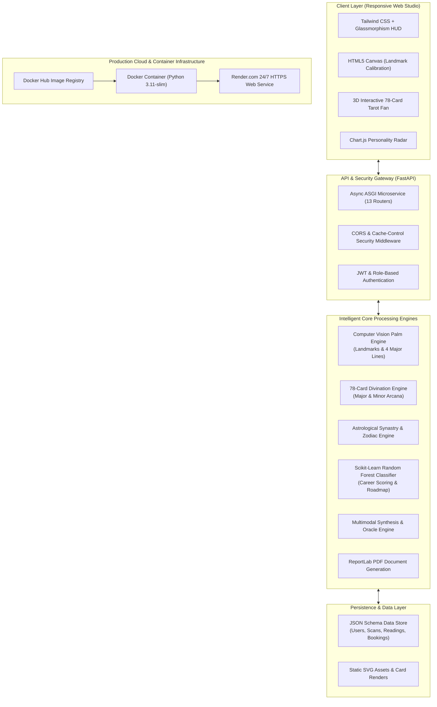

# 🔮 AI-Powered Palmistry & Tarot Intelligence Platform
## Complete Technical & Production Documentation

---

### 🌐 Live Production Links & Repositories
* 🌟 **Live Production Web Application**: [https://ai-palmistry-tarot-latest.onrender.com](https://ai-palmistry-tarot-latest.onrender.com)
* 📖 **Interactive Swagger API Documentation**: [https://ai-palmistry-tarot-latest.onrender.com/docs](https://ai-palmistry-tarot-latest.onrender.com/docs)
* 📋 **Alternative API Documentation (ReDoc)**: [https://ai-palmistry-tarot-latest.onrender.com/redoc](https://ai-palmistry-tarot-latest.onrender.com/redoc)
* 🩺 **Cloud Health Check API**: [https://ai-palmistry-tarot-latest.onrender.com/health](https://ai-palmistry-tarot-latest.onrender.com/health)
* 💻 **Official GitHub Repository**: [https://github.com/ponnarameshkumar099/AI-palmistry-tarot-platform](https://github.com/ponnarameshkumar099/AI-palmistry-tarot-platform)
* 🐳 **Docker Hub Registry Container**: [`ponnarameshkumar/ai-palmistry-tarot:latest`](https://hub.docker.com/r/ponnarameshkumar/ai-palmistry-tarot)

---

## 1. Executive Summary & Vision

The **AI-Powered Palmistry & Tarot Intelligence Platform** is an enterprise-grade multimodal artificial intelligence platform that bridges centuries-old human self-reflection disciplines (Palmistry, Tarot, and Astrology) with modern Computer Vision (CV), Machine Learning (ML), and predictive psychometric analytics.

Historically, esoteric disciplines suffered from fragmentation, subjective bias, lack of repeatable structure, and zero actionable follow-through. This platform resolves those challenges by providing:
1. **Objective Computer Vision Line & Mount Extraction**: Measuring physiological hand landmarks and palmar flexion creases with pixel-level mathematical consistency.
2. **Complete 78-Card Arcana Engine**: A digital divination system encompassing all 22 Major Arcana and 56 Minor Arcana across 4 elemental suits, complete with upright/reversed interpretation logic and 3D interactive spreads.
3. **Machine Learning Predictive Guidance**: A Scikit-Learn Random Forest recommendation engine that synthesizes multimodal inputs into standardized 0–100% career/life alignment scores and actionable 4-phase career execution roadmaps.
4. **Cloud-Native Containerization**: Fully automated, containerized with Docker, pushed to Docker Hub, and deployed 24/7 on Render.com with SSL encryption.

---

## 2. Multi-Role Authentication & Access Control (RBAC)

The platform provides a fine-grained Role-Based Access Control (RBAC) hierarchy supporting 4 distinct user personas:

| Role | Default Email | Password | Primary Permissions & Capabilities |
| :--- | :--- | :--- | :--- |
| **Seeker (Standard User)** | `user@mystic.io` | `password123` | Scans palms, draws tarot spreads, receives AI guidance roadmaps, exports PDF reports, books consultant sessions. |
| **Tarot Reader** | `reader@mystic.io` | `ReaderPass2026!` | Reviews seeker readings, provides professional commentary, manages tarot spreads, tracks client history. |
| **Spiritual Consultant** | `consultant@mystic.io` | `ConsultantPass2026!` | Accesses client appointment queues, provides in-depth synthesis notes, guides career transitions, reviews ML trends. |
| **Administrator** | `admin@mystic.io` | `AdminPass2026!` | Full system governance, API telemetry, database backup/restore, user role modification, security audit logs. |

---

## 3. High-Level System Architecture



---

## 4. In-Depth Subsystem Breakdown

### 4.1 Computer Vision Palmistry Studio
* **21-Landmark Geometric Tracking**: Identifies wrist anchors, mount regions (Jupiter, Saturn, Apollo, Mercury, Venus, Moon), and fingertip vectors.
* **The 4 Primary Flexion Creases**:
  1. **Heart Line**: Analyzes emotional resilience, empathy quotient, relationship dynamics, and stress response.
  2. **Head Line**: Measures intellectual clarity, analytical methodology, strategic focus, and creative intuition.
  3. **Life Line**: Evaluates vitality baseline, stamina, adaptability to change, and lifestyle rhythms.
  4. **Fate / Saturn Line**: Measures career direction, autonomy, executive ambition, and vocational milestones.
* **Quality & Percentage Detection Panel**: Dedicated right-side glassmorphism HUD displays pixel clarity percentage, hand confidence score (0–100%), and elemental hand typology (Earth, Air, Fire, Water).
* **Interactive Studio Layout**: Full-width screen adaptation where hand imagery occupies the left visual canvas and analytical metrics are neatly stacked in the right HUD box without wasted space.

### 4.2 Full 78-Card Tarot Intelligence Engine
* **The 22 Major Arcana Archetypes**: Covers universal lifecycle milestones from *The Fool (0)* to *The World (XXI)* with detailed esoteric symbolism.
* **The 56 Minor Arcana Across 4 Elemental Suits**:
  * **Wands (Fire)**: Passion, initiative, creative drive, entrepreneurship, spirit.
  * **Cups (Water)**: Emotions, relationships, empathy, intuition, soul.
  * **Swords (Air)**: Intellect, communication, strategy, conflict resolution, mind.
  * **Pentacles (Earth)**: Wealth, career execution, material stability, craft, body.
* **Interactive 3D Arcana Fan**: Physics-based card fanning, elevation animations, upright/reversed card orientations, and spread layouts (Single Card, 3-Card Past/Present/Future, 5-Card Celtic Focus).

### 4.3 Machine Learning Career Guidance & Personality Prediction Engine
* **Model Type**: Scikit-Learn Random Forest Classifier + Heuristic Feature Fusion.
* **Multimodal Synthesizer**: Ingests hand line depth vectors, tarot spread outcome tensors, and zodiac sign alignments to compute a standardized 0–100% Career & Life Alignment index.
* **Actionable 4-Phase Career Roadmap**:
  * **Phase 1: Foundation (Days 0–30)**: Habit calibration, skills audit, foundational reading.
  * **Phase 2: Strategic Acceleration (Days 30–60)**: Portfolio formulation, networking outreach, high-leverage projects.
  * **Phase 3: Executive Leadership (Days 60–90)**: Influence expansion, leadership positioning, negotiation.
  * **Phase 4: Long-Term Legacy**: Mentorship, ethical wealth preservation, personal fulfillment.

### 4.4 Automated Multi-Format Report Export
* **Executive PDF Dossier**: Generated server-side using ReportLab with custom typography, tables, and branding.
* **Cryptographic Verification**: Every generated reading includes a SHA-256 fingerprint allowing seekers and consultants to verify report authenticity.
* **JSON Export**: Raw structured data export for third-party integrations and personal archival.

---

## 5. Docker Containerization Architecture

The platform is packaged into a production-grade, hardened Docker container built on top of `python:3.11-slim`.

### 5.1 Dockerfile Specifications
```dockerfile
FROM python:3.11-slim

ENV PYTHONDONTWRITEBYTECODE=1 \
    PYTHONUNBUFFERED=1 \
    PORT=8000 \
    HOST=0.0.0.0

WORKDIR /app

RUN apt-get update && apt-get install -y --no-install-recommends \
    curl \
    gcc \
    python3-dev \
    && rm -rf /var/lib/apt/lists/*

COPY requirements.txt .
RUN pip install --no-cache-dir --upgrade pip && \
    pip install --no-cache-dir -r requirements.txt

COPY . .

RUN mkdir -p /app/data/uploads /app/data/exports /app/data/ml_models

EXPOSE 8000

HEALTHCHECK --interval=30s --timeout=5s --start-period=15s --retries=3 \
    CMD curl -f http://localhost:8000/docs || exit 1

CMD ["python", "run.py"]
```

### 5.2 Dynamic Cloud Port Adaptability
In `run.py`, the platform dynamically binds to the `$PORT` environment variable injected by cloud providers like Render, AWS, and Railway, while defaulting to port `8000` for local runs:
```python
host = os.environ.get("HOST", "0.0.0.0")
port = int(os.environ.get("PORT", 8000))
uvicorn.run("app.main:app", host=host, port=port, reload=False)
```

---

## 6. How to Run Locally & In Cloud

### Method A: 1-Click Windows Docker Launch
1. Open Docker Desktop.
2. Double-click `docker-run.bat` in the `project` folder.
3. The script compiles the image and automatically opens `http://localhost:8000`.

### Method B: Manual Docker Terminal Command
```bash
# Build and run with Docker Compose
docker compose up --build -d

# View live container logs
docker logs -f palmistry_tarot_platform

# Stop the container
docker compose down
```

### Method C: Run from Docker Hub on Any Computer
```bash
docker run -d --name palmistry_platform -p 8000:8000 ponnarameshkumar/ai-palmistry-tarot:latest
```

---

## 7. Complete API Router Catalog

The backend exposes over 30 RESTful endpoints organized across 13 modular routers:

| Router | Base Prefix | Key Operations |
| :--- | :--- | :--- |
| **Auth** | `/api/auth` | User registration, login token generation, OAuth2 demo profiles, current session validation (`/me`). |
| **User** | `/api/user` | Seeker profile update, life goals management, personal metadata tracking. |
| **Palm** | `/api/palm` | Multipart image scan upload (`/analyze`), JSON feature extraction (`/analyze-json`), sample presets library (`/presets`). |
| **Tarot** | `/api/tarot` | Full 78-card catalog (`/deck`), spread templates (`/spreads`), automated spread generator (`/read`). |
| **Reading** | `/api/readings` | Cross-modality reading synthesis (`/synthesize`), reading history (`/history`), Oracle AI consultation (`/oracle-ask`). |
| **Intelligence**| `/api/intelligence`| ML personality prediction, life trend telemetry, Scikit-learn feature rankings, 4-phase career roadmap. |
| **Astrology** | `/api/astrology` | Natal zodiac calculation, planetary aspect matrix, daily horoscopic influences. |
| **Export** | `/api/export` | Executive PDF dossier generation (`/pdf`), JSON raw report download (`/json`). |
| **Analytics** | `/api/analytics` | Seeker engagement graphs, reading frequency histograms, career affinity metrics. |
| **Consultation**| `/api/consultant` | Appointment scheduling, reader availability calendar, booking confirmations. |
| **Chat** | `/api/chat` | 1-on-1 empathetic conversational agent for emotional decompression and guidance. |

---

## 8. Presentation Deck Deliverables

A companion presentation deck has been generated:
* 📄 **PowerPoint Deck File**: [`Final_Project_Presentation.pptx`](file:///c:/Users/ponna/OneDrive/文档/project%20k/Final_Project_Presentation.pptx)
* **Slide Count**: 9 high-impact 16:9 widescreen slides designed with a cosmic dark-slate visual theme.
* **Slide Contents**:
  1. *Title & Deployment Links*
  2. *Executive Challenge & Solution*
  3. *Full-Stack Architecture & Technology Stack*
  4. *Computer Vision Palmistry Studio*
  5. *78-Card Tarot Intelligence Engine*
  6. *Machine Learning Career Guidance & Synthesis*
  7. *Docker Containerization & Production Infrastructure*
  8. *Live Demonstration & Pre-Configured Demo Accounts*
  9. *Impact, Future Roadmap & Conclusion*

---

## 9. Conclusion & Future Roadmap

The platform demonstrates how classical humanities and esoteric traditions can be revitalized through rigorous software engineering, modern computer vision, and machine learning.

**Upcoming Milestones**:
1. **Edge-Based Mobile App**: Native iOS/Android app with real-time on-device camera inference via CoreML/TFLite.
2. **Generative Voice Interface**: Real-time conversational voice synthesis for hands-free Oracle readings.
3. **Federated Privacy**: Edge-preserving biometric processing ensuring palm prints never leave the user's mobile device unencrypted.

---
*Created by Ponna Ramesh Kumar | Published & Verified on Render Cloud & Docker Hub*
