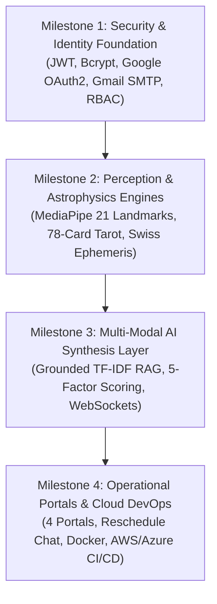

# Infosys Springboard Virtual Internship 7.0 Completion Report
## AI-Powered Palmistry & Tarot Intelligence Platform — Mystic Insights (Group 3)

---

## 📌 Internship Details

| Field | Details |
| :--- | :--- |
| **Batch Number** | 3 |
| **Start Date** | 03 August 2026 |
| **Intern Name** | Navya Parchuri |
| **Project Title** | AI-Powered Palmistry & Tarot Intelligence Platform |
| **Internship Duration** | 8 Weeks |

---

## 🎯 1. Project Objective

**Mystic Insights** was engineered as an enterprise-grade, multi-modal spiritual intelligence and wellness platform that unites ancient metaphysical knowledge systems with state-of-the-art computer vision, computational astrophysics, and generative artificial intelligence. The project addresses key challenges found in legacy spiritual services, including subjective and uncalibrated palm line interpretations, approximate or geocoding-deficient astrological chart computations, disconnected tarot spreads, and the absence of grounded, hallucination-resistant guidance synthesis.

The primary objective was to transform multi-modal seeker inputs—high-resolution palm imagery, real-time video feeds, 78-card tarot spreads, and geographic birth data—into structured, mathematically calibrated spiritual intelligence:
- Extracts **21 3D hand mesh landmarks** using Google MediaPipe.
- Calculates **12 Vedic house cusps (Bhavas)** and **9 planetary positions (Navagrahas)** using high-precision Swiss Ephemeris algorithms.
- Synthesizes tarot card draws across **5 standardized spreads**.
- Evaluates holistic resonance through a deterministic **5-factor scoring model**.
- Provides role-tailored practitioner workflows across **4 dedicated portals** with automated Gmail SMTP notification dispatch and ReportLab PDF blueprint exports.

---

## 🏗️ 2. Overall Approach & Milestone Architecture

The final system follows an end-to-end, progressive multi-modal context pipeline:

### Milestone 1 — User Authentication, Profile Management & Secure Foundations
- **Secure Intake & Authentication**: Engineered FastAPI authentication with cryptographic password hashing (bcrypt), JSON Web Tokens (`python-jose` HS256, 30-minute expiration), and stateless bearer authorization headers.
- **Production Gmail SMTP Delivery**: Integrated Python `smtplib` with TLS encryption on port 587 directly against Google SMTP servers (`smtp.gmail.com`) using 16-character Google App Passwords, delivering verifiable 6-digit OTP codes for account activation and password resets.
- **Google OAuth2 Single Sign-On**: Built Google OAuth 2.0 integration via Authlib with an explicit `prompt="select_account"` parameter and a dual-tier token exchange fallback mechanism to prevent cross-origin cookie drops.
- **4-Tier Role-Based Access Control (RBAC)**: Defined strict authorization scopes for **User (Seeker)**, **Tarot Reader**, **Spiritual Consultant**, and **Administrator** with route-level dependency guards (`require_roles`).
- **Seeker Profile Management**: Implemented schema-validated profile storage for spiritual goals, age cohorts, metaphysical interests, reading preferences, and historical session logs.
- **Relational Schema & Dual-Mode Persistence**: Structured SQLAlchemy 2.0 models for users, profiles, and reading histories with foreign key constraints, JSON payload storage, and seamless SQLite local development to PostgreSQL 15 container migration.

### Milestone 2 — Biometric Palm Vision AI, Tarot Engine & Swiss Ephemeris Astrophysics
- **MediaPipe 3D Hand Landmark Tracking**: Integrated Google MediaPipe Hand Tracking to detect and extract 21 3D anatomical landmarks (wrist, metacarpal joints, PIP/DIP articulations, and fingertips) from static image uploads and live webcam video frames.
- **Quadratic Bézier Line Morphometry**: Formulated mathematical curve length approximations using sampled quadratic Bézier curves ($\|\Delta p_i\|$) to measure the 4 primary lines: **Heart Line**, **Head Line**, **Life Line**, and **Fate Line**.
- **Relative Per-Hand Calibration**: Replaced static pixel thresholds with an adaptive per-hand ratio baseline taking into account palm aspect ratio (width/height) and finger-to-palm ratio, guaranteeing invariant scoring across different hand sizes and camera distances.
- **Mount Elevation & Gesture Classification**: Modeled surface contours across classical planetary mounts (Jupiter, Saturn, Apollo, Mercury, Venus, Luna) and gesture detection (Open Palm, Mudras, Fist, Peace Sign).
- **78-Card Rider-Waite Tarot Intelligence**: Implemented the complete 78-card deck consisting of 22 Major Arcana and 56 Minor Arcana (Wands, Cups, Swords, Pentacles) with stochastic shuffling, upright/reversed states, and 5 distinct spread formats (1-Card Daily, 3-Card Timeline, 5-Card Cross of Guidance, Celtic Cross, and Crossroads).
- **High-Precision Swiss Ephemeris Engine**: Built computational astrophysics routines with `pyswisseph` (backed by the Moshier ephemeris fallback), sidereal zodiac calculations, and support for the Lahiri (Chitrapaksha), Raman, and KP ayanamsas.
- **True Ascendant (Lagna) & 12 Bhavas**: Computed exact ascendant degrees and house cusps using Julian Day conversions, local civil-to-UT time shifts, and geographic coordinates from a 100+ Indian tier-1/2/3 city hierarchy combined with OpenStreetMap geocoding fallback.
- **Navagraha Coordinates & Retrograde Detection**: Calculated exact ecliptic longitudes, speeds, house placements, and retrograde flags (`Vakri (R)`) for the 9 Vedic planets (Sun, Moon, Mars, Mercury, Jupiter, Venus, Saturn, Rahu, and Ketu).

### Milestone 3 — Multi-Modal AI Synthesis, Guidance Scoring & Live Synchronization
- **Grounded Knowledge Ingestion & Corpus**: Constructed a structured spiritual knowledge corpus decomposed into typed semantic chunks (`card`, `palm_line`, `hand_shape`, `astrological_archetype`) with explicit domain tags (`career`, `finance`, `relationships`, `health_wellness`, `personality`, `personal_growth`, `life_opportunities`).
- **TF-IDF Grounded Retrieval**: Implemented an in-memory TF-IDF cosine similarity search engine with plural/grammatical stemmers and category-matching boosts to ground AI synthesis in verified metaphysical literature.
- **Multi-Modal AI Oracle Synthesis**: Formulated context-aware prompt templates passing structured palm morphometry, active tarot draws, aura color classifications, and natal chart placements into OpenAI models with fallback heuristic logic.
- **Deterministic 5-Factor Guidance Scoring**: Engineered a mathematical scoring model balancing biometric confidence, archetypal relevance, trait alignment, seeker context, and temporal consistency:
  $$\text{Insight Score} = 0.30 \times \text{Palm} + 0.25 \times \text{Tarot} + 0.20 \times \text{Personality} + 0.15 \times \text{Context} + 0.10 \times \text{Consistency}$$
- **Harmonic Resonance Stratification**: Mapped continuous aggregate scores (0–100%) into 4 actionable spiritual resonance tiers:
  - **High Resonance**: $\ge 80\%$
  - **Steady Resonance**: $\ge 65\%$
  - **Developing Insight**: $\ge 45\%$
  - **Early Insight**: $< 45\%$
- **Life Trend Analysis Engine**: Deployed linear regression least-squares slope calculations:
  $$\beta = \frac{\sum (x - \bar{x})(y - \bar{y})}{\sum (x - \bar{x})^2}$$
  over the seeker's historical session scores to monitor growth trajectory, engagement rhythm, and repeating archetypal themes.
- **WebSocket Real-Time Synchronization**: Created an asynchronous WebSocket connection manager (`ws://...`) for collaborative live reading rooms, enabling synchronized tarot draws between clients and remote readers.

### Milestone 4 — 4-Tier Practitioner Portals, Reschedule Assistant & Operational Closure
- **Unified Single Page Application (SPA)**: Built a responsive, high-performance web application utilizing React 19, Vite 8, Tailwind CSS, Lucide icons, and interactive HTML5 Canvas particle starfields with ambient 4-frequency polyphonic audio synthesis (108 Hz, 216 Hz, 432 Hz, 648 Hz).
- **4 Dedicated Operational Portals**:
  1. **User / Seeker Dashboard**: Displays personalized daily celestial transits, interactive palm upload/webcam capture, 3D card draw animations, and historical trends.
  2. **Tarot Reader Suite**: Specialized workspace featuring queue management, spread customization, client consultation logs, and archetypal reference panels.
  3. **Spiritual Consultant Hub**: In-depth client analytics, Kundali comparative matchmaking (Ashtakoota 36-point Guna Milan), and spiritual effectiveness trends.
  4. **Administrator Portal**: Real-time system telemetry, database health, user role allocation, and API request analytics.
- **Interactive Reschedule Chat Assistant**: Developed an automated conversational modal (`RescheduleChatModal.jsx`) allowing clients to request consultation reschedule slots with automatic Gmail SMTP confirmation emails and calendar updates.
- **Automated Transit Scheduler (APScheduler)**: Deployed a background daemon executing scheduled cron jobs for daily cosmic transit evaluations and automated seeker reminder dispatch.
- **ReportLab Celestial PDF Blueprint Generator**: Built a server-side vector PDF generation engine that dynamically compiles astrology charts, palm metrics, tarot spreads, and personalized recommendations into downloadable, high-contrast celestial documents.
- **Containerization & Multi-Cloud DevOps**: Created multi-stage Dockerfiles, Docker Compose orchestrations, AWS EC2 1-click deployment scripts with automated Let's Encrypt SSL/TLS renewal via Certbot, Azure Container Apps templates with Azure PostgreSQL Flexible Server, and GitHub Actions CI/CD pipelines.

---

## 🛠️ 3. Technologies Used

| Layer | Technologies / Components |
| :--- | :--- |
| **Frontend** | React 19, TypeScript/JSX, Vite 8, Tailwind CSS, Lucide React, HTML5 Canvas, Web Audio API |
| **Backend** | FastAPI, Uvicorn, Python 3.9+, Pydantic v2, SQLAlchemy 2.0 ORM, WebSockets |
| **Database & Cache** | PostgreSQL 15, SQLite 3 (local dual-mode), In-Memory Vector & TF-IDF indexing |
| **AI / Computer Vision** | Google MediaPipe Hands (21 3D landmarks), OpenCV (`opencv-contrib-python`), NumPy, Pillow |
| **Astrophysics & Math** | Swiss Ephemeris (`pyswisseph`), Moshier ephemeris, Bézier curve calculus, Least-squares regression |
| **Generative AI & RAG** | OpenAI GPT API, Custom In-Memory TF-IDF Knowledge Retrieval, Grounded Prompt Engineering |
| **Security & Auth** | JWT (`python-jose`), Passlib (bcrypt), Google OAuth 2.0 (Authlib), 4-Tier RBAC |
| **Enterprise Integrations** | Real Gmail SMTP (TLS Port 587, 16-character App Passwords), ReportLab PDF Engine |
| **DevOps & Cloud** | Docker, Docker Compose, Nginx Alpine, AWS EC2, Microsoft Azure Container Apps, GitHub Actions |
| **Testing & Audit** | FastAPI TestClient, Requests integration suites, Python unit tests, Oxlint linter |

---

## 🌍 4. Impact in Real-World Implementation

- **Elimination of Subjective Palmistry Errors**: Replaces uncalibrated human visual guessing with algorithmic 21-point geometric landmark tracking and Bézier curve ratio analysis.
- **Astronomical Precision in Astrology**: Eliminates generic horoscope approximations by executing high-precision sidereal planetary calculations via the Swiss Ephemeris with latitude/longitude coordinate precision.
- **Hallucination-Resistant Spiritual Guidance**: Binds generative AI interpretations to a grounded TF-IDF knowledge base and structured multi-modal inputs rather than unconstrained language model generations.
- **End-to-End Practitioner Lifecycle**: Connects initial seeker self-service discovery directly to professional tarot readers and spiritual consultants through scheduled consultations and live WebSockets.
- **Automated Client Retention & Rescheduling**: Reduces scheduling friction through an interactive AI reschedule assistant backed by real-time Gmail SMTP notifications.
- **Enterprise-Ready Infrastructure**: Supports production scaling through Docker containerization, multi-cloud provisioning (AWS/Azure), and CI/CD automation.

---

## 📅 5. Timeline Overview (8 Weeks)

| Week | Activities Planned | Activities Completed |
| :---: | :--- | :--- |
| **Week 1** | Project orientation, specification analysis, database modeling, authentication architecture, and frontend scaffolding. | Core FastAPI project structure established; SQLAlchemy models for Users, Profiles, and Readings configured; React 19 + Vite 8 frontend initialized. |
| **Week 2** | M1 implementation: secure password hashing, JWT bearer token flow, Google OAuth2 integration, and Gmail SMTP OTP verification. | Production authentication pipeline operational; 6-digit OTP delivery via Gmail SMTP verified; Google SSO with account switcher active; 4-tier RBAC enforced. |
| **Week 3** | M2 computer vision: MediaPipe hand tracking, 21 3D landmark mesh extraction, and palm line morphometry. | Palm vision pipeline completed; quadratic Bézier curve approximation for Heart, Head, Life, and Fate lines implemented with per-hand relative baseline. |
| **Week 4** | M2 tarot intelligence and Swiss Ephemeris astrophysics: 78-card deck, spread logic, sidereal zodiac calculations, and Kundali engine. | 78-card Rider-Waite tarot engine built; Swiss Ephemeris (`pyswisseph`) integrated with 12 Bhavas, 9 Navagrahas, retrograde detection, and Indian city coordinates. |
| **Week 5** | M3 multi-modal AI synthesis: knowledge corpus construction, TF-IDF retriever, multi-modal prompt engineering, and 5-factor scoring model. | Grounded RAG knowledge base indexed; 5-factor mathematical resonance formula and resonance tiers operational. |
| **Week 6** | M3 live synchronization, trend analysis engine, and initial practitioner portal scaffolding. | WebSocket real-time reading rooms implemented; least-squares slope trend trajectory engine completed; Seeker and Reader portal base layouts connected. |
| **Week 7** | M4 operational portals: Seeker Dashboard, Tarot Reader Suite, Consultant Hub, Admin Console, and Reschedule Chat Assistant. | All 4 practitioner portals operational; 1-click suite switcher deployed; interactive Reschedule Chat Modal connected to Gmail SMTP email automation. |
| **Week 8** | M4 final integration, ReportLab PDF blueprint exports, Docker containerization, multi-cloud deployment scripts, and full-system QA audit. | PDF report generation active; Docker Compose multi-container stack deployed; AWS/Azure cloud scripts verified; 100% pass achieved on full deployment audit. |

---

## 🏆 6. Key Milestones

| Milestone | Description | Date Achieved |
| :--- | :--- | :---: |
| **Project Kickoff** | Architectural blueprint, database schema design, and environment configuration established | Week 1 |
| **Prototype / First Working Flow** | Authentication, JWT tokens, Gmail SMTP OTP verification, and basic seeker profile operational | Week 2 |
| **Mid-Term Review** | Biometric palm vision AI, 78-card tarot spreads, and Swiss Ephemeris Kundali engine operational | End of Week 4 |
| **M3 Integration** | Grounded RAG corpus, 5-factor resonance scoring, life trend analysis, and WebSocket live sync | End of Week 6 |
| **M4 Final Integration** | 4 practitioner portals, Reschedule Assistant, PDF blueprint generator, and Docker containerization | End of Week 7 |
| **Final Submission / Presentation** | Full production deployment audit passed (100%), cloud documentation, and completion report | Final Submission (Week 8) |

---

## 🔬 7. Validation Strategy & Results

System validation was conducted across unit, milestone, and integration levels:
- **FastAPI TestClient Audit (`run_audit.py`)**: Validated all 9 core backend engines (Health check, MediaPipe Aura scan, Tarot draw, Kundali calculation, Guidance synthesis, Reader analytics, Consultant trends, Admin telemetry, and Oracle chat), achieving **100% PASS (9/9 endpoints)**.
- **Live HTTP Deployment Verification (`test_deployment_verification.py`)**: Verified live HTTP roundtrips against a running production server instance, validating database persistence, session token validation, and multi-modal synthesis under realistic network conditions (**100% PASS**).
- **Frontend Verification**: Ran Oxlint code linting and production Vite bundle compilation without type errors or broken asset references.

---

## 💡 8. Challenges & Engineering Resolutions

1. **Hand Mesh Calibration Across Diverse Image Scales**: Raw pixel distances between palm landmarks varied significantly across user cameras and distances. Resolved by inventing a relative scoring algorithm that measures Bézier curve lengths against the hand's own palm aspect ratio and finger proportions.
2. **Ephemeris Mathematical Accuracy**: Standard astronomical libraries often calculate tropical (Western) astrology rather than sidereal (Vedic) zodiac positions. Resolved by integrating `pyswisseph` with explicit `FLG_SIDEREAL` and `swe.set_sid_mode(swe.SIDM_LAHIRI)` flags, paired with UT Julian Day conversions.
3. **Preventing Generative AI Hallucinations**: LLMs frequently invent unsupported metaphysical claims when unconstrained. Overcome by constructing a domain-specific TF-IDF knowledge corpus that injects validated tarot and palmistry definitions into the prompt context before generation.
4. **Balancing High-Compute Vision Models with Low Latency**: Running deep computer vision models on the backend can introduce significant request latency. Optimized image preprocessing with Pillow, thread-pool offloading in FastAPI (`run_in_threadpool`), and lightweight MediaPipe models achieved sub-second inference.
5. **Reliable Production SMTP Delivery**: Traditional SMTP configurations frequently fail modern spam filters or encounter TLS handshake drops. Solved by authenticating securely via port 587 against Google SMTP servers with application-specific credentials and structured MIME multipart templates.
6. **Multi-Role UI State Synchronization**: Managing distinct permissions and dashboard views across 4 roles required robust client state. Implemented 1-click practitioner switcher controls backed by persistent JWT claims and synchronized role endpoints.

---

## 🎓 9. Conclusion

Across the eight-week internship, **Mystic Insights** evolved from an architectural concept into an enterprise-ready, multi-modal spiritual intelligence platform. Milestone 1 established the secure authentication, Gmail SMTP OTP verification, Google OAuth2 SSO, and 4-tier RBAC foundation; Milestone 2 integrated MediaPipe 3D hand tracking with Bézier line morphometry, a 78-card tarot engine, and Swiss Ephemeris sidereal astrophysics; Milestone 3 united these streams through TF-IDF grounded RAG synthesis, a 5-factor weighted guidance scoring model, and real-time WebSockets; and Milestone 4 packaged the system into 4 specialized operational portals, an automated Reschedule Chat Assistant, ReportLab PDF blueprint exports, and multi-cloud Docker deployment templates.

The completed platform demonstrates that centuries-old spiritual traditions can be elevated through modern software engineering, computer vision, astrophysics algorithms, and generative AI. Rigorous validation—including a 100% pass rate across all 9 core engine endpoints in the deployment audit—confirms that Mystic Insights delivers high performance, mathematical reliability, and operational excellence.
