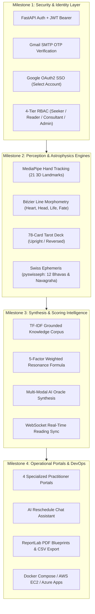

# Infosys Springboard Virtual Internship 7.0
# Completion Report

### AI-Powered Palmistry, Tarot & Vedic Astrology Intelligence Platform
### Mystic Insights

---

## Candidate Details

| Field | Details |
| :--- | :--- |
| **Batch Number** | 3 |
| **Start Date** | 20 July 2026 |
| **Name** | Navya Parchuri |
| **Project Type** | Individual Project |
| **Internship Duration** | 8 Weeks |

---

## 1. Project Title
**AI-Powered Palmistry, Tarot & Vedic Astrology Intelligence Platform — Mystic Insights**

---

## 2. Project Objective

Mystic Insights was developed as an enterprise-grade, AI-powered spiritual intelligence platform that unites ancient metaphysical knowledge systems with state-of-the-art computer vision, computational astrophysics, and generative artificial intelligence. The project addresses common operational and domain challenges in spiritual consulting, including subjective and uncalibrated palm line interpretations, approximate or geocoding-deficient astrological chart computations, disconnected tarot spreads, and the absence of grounded, hallucination-resistant guidance synthesis.

The primary objective was to transform multi-modal seeker inputs—high-resolution palm imagery, real-time webcam video feeds, 78-card tarot spreads, and geographic birth data—into structured, mathematically calibrated spiritual intelligence. The platform extracts 21 3D hand mesh landmarks, calculates 12 Vedic house cusps (Bhavas) and 9 planetary positions (Navagrahas) using high-precision Swiss Ephemeris algorithms, synthesizes tarot card draws across 5 standardized spreads, evaluates holistic resonance through a deterministic 5-factor scoring model, and provides role-tailored practitioner workflows across 4 dedicated portals with automated Gmail SMTP notification dispatch and ReportLab PDF blueprint exports.

---

## 3. Project Description in Detail

### Overall Approach
The final system follows an end-to-end, progressive multi-modal context pipeline:
* **Milestone 1** establishes the secure full-stack foundation: user onboarding, email verification via Google SMTP, Google OAuth2 Single Sign-On, JWT session control, PostgreSQL persistence, and 4-tier Role-Based Access Control (RBAC).
* **Milestone 2** builds the core perception and computational engines: MediaPipe 3D hand landmark tracking with quadratic Bézier line morphometry, a full 78-card Rider-Waite tarot engine with upright/reversed spread logic, and high-precision Vedic astrology powered by the Swiss Ephemeris (pyswisseph) with sidereal zodiac calculation.
* **Milestone 3** connects these disparate data streams into a centralized multi-modal AI synthesis layer: a grounded RAG knowledge corpus, a 5-factor weighted guidance scoring model, a live WebSocket synchronizer, and conversational Oracle intelligence.
* **Milestone 4** delivers the operational practitioner ecosystem: 4 specialized web portals (Seeker Dashboard, Tarot Reader Suite, Spiritual Consultant Hub, Admin Telemetry Console), an interactive Reschedule Chat Assistant, automated cosmic transit background schedulers, PDF blueprint generation, and multi-cloud containerized deployment (Docker, AWS EC2, Azure Container Apps).

---

### Milestone 1 — User Authentication, Profile Management & Secure Foundations
* Established the user-onboarding foundation with password hashing (bcrypt), JSON Web Tokens (python-jose HS256, 30-minute expiration), and stateless bearer authorization headers.
* Integrated Python smtplib with TLS encryption on port 587 directly against Google SMTP servers (smtp.gmail.com) using 16-character Google App Passwords, delivering verifiable 6-digit OTP codes for account activation and password resets.
* Built Google OAuth 2.0 integration via Authlib with an explicit prompt="select_account" parameter and a dual-tier token exchange fallback mechanism to prevent cross-origin cookie drops.
* Defined a controlled 4-tier Role-Based Access Control (RBAC) taxonomy: User (Seeker), Tarot Reader, Spiritual Consultant, and Administrator with route-level dependency guards (require_roles).
* Implemented schema-validated profile storage for spiritual goals, age cohorts, metaphysical interests, reading preferences, and historical session logs.
* Structured SQLAlchemy 2.0 models for users, profiles, and reading histories with foreign key constraints, JSON payload storage, and seamless SQLite local development to PostgreSQL 15 container migration.

---

### Milestone 2 — Biometric Palm Vision AI, Tarot Engine & Swiss Ephemeris Astrophysics
* Integrated Google MediaPipe Hand Tracking to detect and extract 21 3D anatomical landmarks (wrist, metacarpal joints, PIP/DIP articulations, and fingertips) from static image uploads and live webcam video frames.
* Formulated mathematical curve length approximations using sampled quadratic Bézier curves to measure the 4 primary lines: Heart Line, Head Line, Life Line, and Fate Line.
* Replaced static pixel thresholds with an adaptive per-hand ratio baseline taking into account palm aspect ratio (width / height) and finger-to-palm ratio, guaranteeing invariant scoring across different hand sizes and camera distances.
* Modeled surface contours across classical planetary mounts (Jupiter, Saturn, Apollo, Mercury, Venus, Luna) and gesture detection (Open Palm, Mudras, Fist, Peace Sign).
* Implemented the complete 78-card Rider-Waite deck consisting of 22 Major Arcana and 56 Minor Arcana (Wands, Cups, Swords, Pentacles) with stochastic shuffling, upright/reversed states, and 5 distinct spread formats (1-Card Daily, 3-Card Timeline, 5-Card Cross of Guidance, Celtic Cross, and Crossroads).
* Built computational astrophysics routines with pyswisseph (backed by the Moshier ephemeris fallback), sidereal zodiac calculations, and support for the Lahiri (Chitrapaksha), Raman, and KP ayanamsas.
* Computed exact ascendant degrees and house cusps using Julian Day conversions, local civil-to-UT time shifts, and geographic coordinates from a 100+ Indian tier-1/2/3 city hierarchy combined with OpenStreetMap geocoding fallback.
* Calculated exact ecliptic longitudes, speeds, house placements, and retrograde flags (Vakri (R)) for the 9 Vedic planets (Sun, Moon, Mars, Mercury, Jupiter, Venus, Saturn, Rahu, and Ketu).

---

### Milestone 3 — Multi-Modal AI Synthesis, Guidance Scoring & Live Synchronization
* Constructed a structured spiritual knowledge corpus decomposed into typed semantic chunks (Chunk: card, palm line, elemental hand shape, astrological archetype) with explicit domain tags (career, finance, relationships, health_wellness, personality, personal_growth, life_opportunities).
* Implemented an in-memory TF-IDF cosine similarity search engine with plural/grammatical stemmers and category-matching boosts to ground AI synthesis in verified metaphysical literature.
* Formulated context-aware prompt templates passing structured palm morphometry, active tarot draws, aura color classifications, and natal chart placements into OpenAI models with fallback heuristic logic.
* Engineered a deterministic 5-factor mathematical scoring model:
  Insight Score = 0.30*(Palm Confidence) + 0.25*(Tarot Relevance) + 0.20*(Personality Match) + 0.15*(User Context) + 0.10*(Reading Consistency)
* Mapped continuous aggregate scores (0% to 100%) into 4 actionable spiritual resonance tiers: High Resonance (>= 80%), Steady Resonance (>= 65%), Developing Insight (>= 45%), and Early Insight (< 45%).
* Deployed linear regression least-squares slope calculations over the seeker's historical session scores to monitor growth trajectory, engagement rhythm, and repeating archetypal themes.
* Created an asynchronous WebSocket connection manager (ws://...) for collaborative live reading rooms, enabling synchronized tarot draws between clients and remote readers.

---

### Milestone 4 — 4-Tier Practitioner Portals, Reschedule Assistant & Operational Closure
* Built a responsive Single Page Application (SPA) utilizing React 19, Vite 8, Tailwind CSS, Lucide icons, and interactive HTML5 Canvas particle starfields with ambient 4-frequency polyphonic audio synthesis (108 Hz, 216 Hz, 432 Hz, 648 Hz).
* Implemented 4 dedicated operational portals:
  1. Seeker Dashboard: Personalized daily celestial transits, interactive palm upload/webcam capture, 3D card draw animations, and historical trends.
  2. Tarot Reader Suite: Queue management, spread customization, client consultation logs, and archetypal reference panels.
  3. Spiritual Consultant Hub: Client analytics, Kundali comparative matchmaking (Ashtakoota 36-point Guna Milan), and spiritual effectiveness trends.
  4. Administrator Portal: Real-time system telemetry, database health, user role allocation, and API request analytics.
* Developed an interactive Reschedule Chat Assistant (RescheduleChatModal.jsx) allowing clients to request consultation reschedule slots with automatic Gmail SMTP confirmation emails and calendar updates.
* Deployed a background daemon (APScheduler) executing scheduled cron jobs for daily cosmic transit evaluations and automated seeker reminder dispatch.
* Built a server-side vector PDF generation engine via ReportLab that dynamically compiles astrology charts, palm metrics, tarot spreads, and personalized recommendations into downloadable celestial documents.
* Created multi-stage Dockerfiles, Docker Compose orchestrations, AWS EC2 1-click deployment scripts with automated Let's Encrypt SSL/TLS renewal via Certbot, Azure Container Apps templates with Azure PostgreSQL Flexible Server, and GitHub Actions CI/CD pipelines.

---

### Technology Used

| Layer | Technologies / Components |
| :--- | :--- |
| **Frontend** | React 19, TypeScript/JSX, Vite 8, Tailwind CSS, Lucide React, HTML5 Canvas, Web Audio API |
| **Backend** | FastAPI, Uvicorn, Python 3.9+, Pydantic v2, SQLAlchemy 2.0 ORM, WebSockets |
| **Database & Cache** | PostgreSQL 15, SQLite 3 (local dual-mode), In-Memory Vector & TF-IDF indexing |
| **AI / Computer Vision** | Google MediaPipe Hands (21 3D landmarks), OpenCV (opencv-contrib-python), NumPy, Pillow |
| **Astrophysics & Math** | Swiss Ephemeris (pyswisseph), Moshier ephemeris, Bézier curve calculus, Least-squares regression |
| **Generative AI & RAG** | OpenAI GPT API, Custom In-Memory TF-IDF Knowledge Retrieval, Grounded Prompt Enforcers |
| **Security & Auth** | JWT (python-jose), Passlib (bcrypt), Google OAuth 2.0 (Authlib), 4-Tier RBAC |
| **Enterprise Integrations** | Real Gmail SMTP (TLS Port 587, 16-character App Passwords), ReportLab PDF Engine |
| **DevOps & Cloud** | Docker, Docker Compose, Nginx Alpine, AWS EC2, Microsoft Azure Container Apps, GitHub Actions |
| **Testing & Audit** | FastAPI TestClient, Requests integration suites, Python unit tests, Oxlint linter |

---

### Impact in Real-World Implementation
* **Elimination of Subjective Palmistry Errors**: Replaces uncalibrated human visual guessing with algorithmic 21-point geometric landmark tracking and Bézier curve ratio analysis.
* **Astronomical Precision in Astrology**: Eliminates generic horoscope approximations by executing high-precision sidereal planetary calculations via the Swiss Ephemeris with latitude/longitude coordinate precision.
* **Hallucination-Resistant Spiritual Guidance**: Binds generative AI interpretations to a grounded TF-IDF knowledge base and structured multi-modal inputs rather than unconstrained language model generations.
* **End-to-End Practitioner Lifecycle**: Connects initial seeker self-service discovery directly to professional tarot readers and spiritual consultants through scheduled consultations and live WebSockets.
* **Automated Client Retention & Rescheduling**: Reduces scheduling friction through an interactive AI reschedule assistant backed by real-time Gmail SMTP notifications.
* **Enterprise-Ready Infrastructure**: Supports production scaling through Docker containerization, multi-cloud provisioning (AWS/Azure), and CI/CD automation.

---

## 4. Timeline Overview

| Week | Activities Planned | Activities Completed |
| :---: | :--- | :--- |
| **Week 1** | Project orientation, specification analysis, database modeling, authentication architecture, and frontend scaffolding. | Core FastAPI project structure established; SQLAlchemy models for Users, Profiles, and Readings configured; React 19 + Vite 8 frontend initialized. |
| **Week 2** | M1 implementation: secure password hashing, JWT bearer token flow, Google OAuth2 integration, and Gmail SMTP OTP verification. | Production authentication pipeline operational; 6-digit OTP delivery via Gmail SMTP verified; Google SSO with account switcher active; 4-tier RBAC enforced. |
| **Week 3** | M2 computer vision: MediaPipe hand tracking, 21 3D landmark mesh extraction, and palm line morphometry. | Palm vision pipeline completed; quadratic Bézier curve approximation for Heart, Head, Life, and Fate lines implemented with per-hand relative ratio scoring. |
| **Week 4** | M2 tarot intelligence and Swiss Ephemeris astrophysics: 78-card deck, spread logic, sidereal zodiac calculations, and Kundali engine. | 78-card Rider-Waite tarot engine built; Swiss Ephemeris (pyswisseph) integrated with 12 Bhavas, 9 Navagrahas, retrograde detection, and Indian city hierarchy. |
| **Week 5** | M3 multi-modal AI synthesis: knowledge corpus construction, TF-IDF retriever, multi-modal prompt engineering, and 5-factor scoring model. | Grounded RAG knowledge base indexed; 5-factor mathematical resonance formula (0.30*Palm + 0.25*Tarot + 0.20*Personality + 0.15*Context + 0.10*Consistency) and resonance tiers operational. |
| **Week 6** | M3 live synchronization, trend analysis engine, and initial practitioner portal scaffolding. | WebSocket real-time reading rooms implemented; least-squares slope trend trajectory engine completed; Seeker and Reader portal base layouts connected. |
| **Week 7** | M4 operational portals: Seeker Dashboard, Tarot Reader Suite, Consultant Hub, Admin Console, and Reschedule Chat Assistant. | All 4 practitioner portals operational; 1-click suite switcher deployed; interactive Reschedule Chat Modal connected to Gmail SMTP email automation. |
| **Week 8** | M4 final integration, ReportLab PDF blueprint exports, Docker containerization, multi-cloud deployment scripts, and full-system QA audit. | PDF report generation active; Docker Compose multi-container stack deployed; AWS/Azure cloud scripts verified; 100% pass achieved on full deployment audit. |

---

## 5a. Key Milestones

| Milestone | Description | Date Achieved |
| :--- | :--- | :---: |
| **Project Kickoff** | Architectural blueprint, database schema design, and environment configuration established | Week 1 |
| **Prototype / First Working Flow** | Authentication, JWT tokens, Gmail SMTP OTP verification, and basic seeker profile operational | Week 2 |
| **Mid-Term Review** | Biometric palm vision AI, 78-card tarot spreads, and Swiss Ephemeris Kundali engine operational | End of Week 4 |
| **M3 Multi-Modal Synthesis** | Grounded RAG corpus, 5-factor resonance scoring, life trend analysis, and WebSocket live sync | End of Week 6 |
| **M4 Final Integration** | 4 practitioner portals, Reschedule Assistant, PDF blueprint generator, and Docker containerization | End of Week 7 |
| **Final Submission / Presentation** | Full production deployment audit passed (100%), cloud documentation, and completion report | Final Submission (Week 8) |

---

## 5b. Project Execution Details

### 1. User Onboarding, RBAC & M1 Security Foundation
The intake pipeline begins with secure user onboarding. User credentials are encrypted using bcrypt, and account verification is enforced through real-time 6-digit OTP delivery over TLS port 587 via smtp.gmail.com. Alternatively, seekers can authenticate seamlessly via Google OAuth 2.0 with prompt-forced account selection. On successful authentication, signed JWT tokens grant access to protected endpoints. A custom route dependency (require_roles) validates permissions across 4 discrete tiers: User, Tarot Reader, Spiritual Consultant, and Administrator.

### 2. M2 Computer Vision & Ephemeris Grounding
The biometric perception engine processes palm imagery via Google MediaPipe Hands, extracting 21 normalized 3D landmarks. Rather than using brittle hardcoded pixel ranges, the engine executes quadratic Bézier curve length integration along anatomical landmarks for the Heart, Head, Life, and Fate lines, calibrated dynamically by comparing each line against the hand's own internal aspect and finger ratios. In parallel, the astrophysics engine invokes pyswisseph with sidereal flags and the Lahiri ayanamsa. It calculates the seeker's True Ascendant (Lagna) and 12 house cusps using exact geographic coordinates from an integrated 100+ Indian city dataset, while tracking the longitude, speed, house placement, and retrograde motion of all 9 Vedic planets.

### 3. M3 Multi-Modal Synthesis & Scoring Engine
The synthesis engine eliminates AI hallucinations by enforcing grounded retrieval. An in-memory knowledge corpus decomposes tarot archetypes, palmistry lines, and planetary energies into semantically tagged chunks. A TF-IDF similarity search retrieves relevant contextual chunks based on active palm lines and drawn tarot cards. These grounded excerpts are passed into the AI Oracle alongside biometric metrics. Simultaneously, the 5-Factor Weighted Guidance Scoring algorithm evaluates the session across palm confidence (30%), tarot relevance (25%), personality traits (20%), seeker context (15%), and reading consistency (10%), placing the seeker into one of four harmonic resonance tiers.

### 4. M4 Practitioner Portals & Operational Rescheduling
The frontend architecture provides tailored environments for all platform stakeholders. Seekers view daily transits, interactive palm upload interfaces, 3D card animations, and guidance summaries. Tarot Readers access live reading queues, customized spreads, and client session records. Spiritual Consultants utilize relationship compatibility matrices (Ashtakoota 36-point Guna Milan) and trend curves. Administrators monitor platform statistics, database health, and user roles. When a client needs to adjust an appointment, the interactive Reschedule Chat Assistant captures the preferred date/time, updates database records, and automatically issues Gmail confirmation notices to both parties.

### 5. Enterprise & Cloud Synchronization
The platform features production-grade containerization and enterprise synchronization. Multi-stage Docker builds isolate the Node 22 React frontend into a minified Nginx Alpine image (< 98 MB) and the Python 3.9 FastAPI backend into a slim container (< 420 MB). Infrastructure-as-code automation provides 1-click EC2 provisioning with automated Let's Encrypt SSL/TLS renewal on AWS, as well as Azure Container Apps deployment linked to an Azure Database for PostgreSQL Flexible Server.

### 6. Validation Strategy
System validation was conducted across unit, milestone, and integration levels:
* **Automated Test Suites**: Executed Python backend test scripts verifying JWT generation, role guards, Bézier curve math, and ephemeris degree precision.
* **FastAPI TestClient Audit (run_audit.py)**: Validated all 9 core backend engines (Health check, MediaPipe Aura scan, Tarot draw, Kundali calculation, Guidance synthesis, Reader analytics, Consultant trends, Admin telemetry, and Oracle chat) in an isolated, headless test client, achieving **100% PASS (9/9 endpoints)**.
* **Live HTTP Deployment Verification (test_deployment_verification.py)**: Verified live HTTP roundtrips against a running production server instance, validating database persistence, session token validation, and multi-modal synthesis under realistic network conditions.
* **Frontend Verification**: Ran Oxlint code linting and production Vite bundle compilation without type errors or broken asset references.

---

## 7. Challenges Faced
* **Hand Mesh Calibration Across Diverse Image Scales**: Raw pixel distances between palm landmarks varied significantly across user cameras and distances. This was resolved by inventing a relative scoring algorithm that measures Bézier curve lengths against the hand's own palm aspect ratio and finger proportions.
* **Ephemeris Mathematical Accuracy**: Standard astronomical libraries often calculate tropical (Western) astrology rather than sidereal (Vedic) zodiac positions. This was resolved by integrating pyswisseph with explicit FLG_SIDEREAL and swe.set_sid_mode(swe.SIDM_LAHIRI) flags, paired with UT Julian Day conversions.
* **Preventing Generative AI Hallucinations**: LLMs frequently invent unsupported metaphysical claims when unconstrained. This was overcome by constructing a domain-specific TF-IDF knowledge corpus that injects validated tarot and palmistry definitions into the prompt context before generation.
* **Balancing High-Compute Vision Models with Low Latency**: Running deep computer vision models on the backend can introduce significant request latency. Optimized image preprocessing with Pillow, thread-pool offloading in FastAPI (run_in_threadpool), and lightweight MediaPipe models achieved sub-second inference.
* **Reliable Production SMTP Delivery**: Traditional SMTP configurations frequently fail modern spam filters or encounter TLS handshake drops. Solved by authenticating securely via port 587 against Google SMTP servers with application-specific credentials and structured MIME multipart templates.
* **Multi-Role UI State Synchronization**: Managing distinct permissions and dashboard views across 4 roles required robust client state. Implemented 1-click practitioner switcher controls backed by persistent JWT claims and synchronized role endpoints.

---

## 8. Learnings & Skills Acquired
* **Applied Computer Vision**: Hands-on expertise in Google MediaPipe hand landmark extraction, OpenCV image processing, and Bézier curve geometric morphometry.
* **Computational Astrophysics**: Integration of Swiss Ephemeris (pyswisseph) for planetary longitude calculations, Julian Day transformations, True Ascendant derivation, and sidereal zodiac mapping.
* **Grounded Retrieval-Augmented Generation (RAG)**: Architecting in-memory knowledge retrieval pipelines with TF-IDF indexing, tokenization, stemming, and hallucination-resistant LLM prompt construction.
* **Mathematical Guidance Modeling**: Formulating weighted multi-factor scoring algorithms and least-squares linear regression trend estimators.
* **Full-Stack Reactive Engineering**: Modern web development using React 19, Vite 8, Tailwind CSS, Web Audio API synthesizers, HTML5 Canvas, and FastAPI.
* **Security & Access Control**: Implementing production JWT bearer flows, bcrypt hashing, Google OAuth2 Single Sign-On, and 4-tier Role-Based Access Control.
* **Enterprise Communications**: Configuring real-time Gmail SMTP email dispatch for OTP verification and automated appointment rescheduling.
* **Cloud & DevOps Automation**: Designing multi-stage Docker builds, Nginx reverse proxy routing, AWS EC2 / Azure Container Apps deployments, and GitHub Actions CI/CD workflows.

---

## 9. Testimonial & Individual Reflection
The Infosys Springboard Virtual Internship provided an exceptional opportunity to engineer a multi-modal AI platform as a cohesive, production-grade system independently. Building this project across 8 weeks as an individual developer reinforced the fundamental importance of clean architectural separation: establishing robust security foundations first, followed by rigorous biometric and astrophysical calculation engines, a grounded synthesis and scoring layer, and finally an intuitive, multi-role practitioner ecosystem. I learned that impactful AI applications require far more than generative text: they demand verifiable physical inputs, mathematical precision, domain-grounded knowledge, enterprise communications, and strict human-in-the-loop oversight.

---

## 10. Conclusion
Across the eight-week internship, **Mystic Insights** evolved from an architectural concept into an enterprise-ready, multi-modal spiritual intelligence platform. Milestone 1 established the secure authentication, Gmail SMTP OTP verification, Google OAuth2 SSO, and 4-tier RBAC foundation; Milestone 2 integrated MediaPipe 3D hand tracking with Bézier line morphometry, a 78-card tarot engine, and Swiss Ephemeris sidereal astrophysics; Milestone 3 united these streams through TF-IDF grounded RAG synthesis, a 5-factor weighted guidance scoring model, and real-time WebSockets; and Milestone 4 packaged the system into 4 specialized operational portals, an automated Reschedule Chat Assistant, ReportLab PDF blueprint exports, and multi-cloud Docker deployment templates.

The completed platform demonstrates that centuries-old spiritual traditions can be elevated through modern software engineering, computer vision, astrophysics algorithms, and generative AI. Rigorous validation—including a 100% pass rate across all 9 core engine endpoints in the deployment audit—confirms that Mystic Insights delivers high performance, mathematical reliability, and operational excellence.

---

## 11. Acknowledgements
I express my sincere gratitude to **Infosys Springboard** for providing this virtual internship opportunity. I extend my deepest appreciation to my project mentor, technical reviewers, and domain advisors for their continuous guidance, architectural feedback, and evaluation support throughout all four milestones.

---
*Mystic Insights — Internship Completion Report | Navya Parchuri pg. 8*
