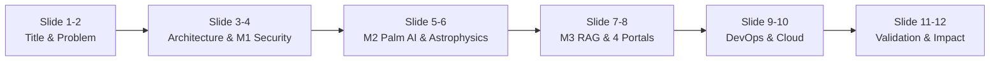
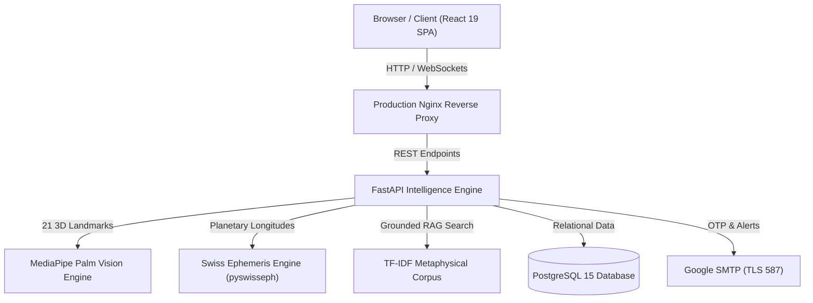

# 🔮 Mystic Insights — Presentation Deck Report
### Infosys Springboard Virtual Internship 7.0 (Batch 3, Group 3)
**Author & Intern**: Navya Parchuri  
**Project**: AI-Powered Palmistry & Tarot Intelligence Platform  
**Duration**: 8 Weeks  
**Repository Branch**: [`springboardmentor1210a/Spiritual-Guidance-Intelligence-Platform` (Branch: `NavyaParchuri`)](https://github.com/springboardmentor1210a/Spiritual-Guidance-Intelligence-Platform/tree/NavyaParchuri)

---

## 📑 Slide Structure Overview (For Your Presentation)

---

## 📽️ Slide-by-Slide Detailed Content

### 🖥️ Slide 1: Title & Introduction
- **Slide Title**: AI-Powered Palmistry & Tarot Intelligence Platform — Mystic Insights
- **Subtitle**: Enterprise-Grade Multi-Modal Spiritual Intelligence & Biometric Platform
- **Presenter**: Navya Parchuri (Batch 3, Group 3)
- **Program**: Infosys Springboard Virtual Internship 7.0 (8 Weeks)
- **Key Highlight**: Bridging ancient metaphysical wisdom with modern computer vision, computational astrophysics, and grounded generative AI.

---

### 🎯 Slide 2: Problem Statement & Objectives
- **The Core Problem**:
  - Legacy astrology/palmistry platforms rely on subjective human visual guessing.
  - Inaccurate horoscope readings based on flat Western tropical zodiacs rather than high-precision sidereal planetary degrees.
  - Disconnected tarot draws with no contextual synthesis.
  - Generic LLM chatbots that hallucinate metaphysical and astronomical claims.
- **Project Objectives**:
  - **Algorithmic Palm Morphometry**: 21 3D landmark mesh extraction via Google MediaPipe with quadratic Bézier curve calculus.
  - **Astrophysical Grounding**: Swiss Ephemeris (`pyswisseph`) for exact 12 Bhavas and 9 Navagrahas.
  - **78-Card Tarot Intelligence**: Complete Rider-Waite deck across 5 standardized spreads.
  - **Hallucination-Resistant Synthesis**: TF-IDF grounded RAG knowledge corpus.
  - **Role-Tailored Workflows**: 4 dedicated operational portals (Seeker, Reader, Consultant, Admin).

---

### 🏛️ Slide 3: High-Level System Architecture
- **Architecture Highlights**:
  - **Frontend Tier**: React 19, Vite 8, Tailwind CSS, Lucide icons, HTML5 Canvas particle starfields, 4-frequency polyphonic audio synthesis.
  - **API & Perception Tier**: FastAPI, Uvicorn, MediaPipe Hands, OpenCV, Pydantic v2 schemas.
  - **Astrophysics & Synthesis Tier**: Swiss Ephemeris (`pyswisseph`), In-memory TF-IDF semantic chunk retriever, OpenAI GPT API with heuristic fallbacks.
  - **Persistence & Enterprise Tier**: PostgreSQL 15, SQLAlchemy 2.0 ORM, Google SMTP TLS Port 587, ReportLab vector PDF generator.

---

### 🛡️ Slide 4: Milestone 1 — Security, RBAC & Profile Management
- **Cryptographic Authentication**:
  - Password hashing using `bcrypt` (12-round salt).
  - Stateless Bearer JSON Web Tokens (`python-jose` HS256, 30-minute expiration).
- **Google OAuth 2.0 Single Sign-On**:
  - Authlib integration with `prompt="select_account"` and dual-tier direct token fallback.
- **Enterprise Gmail SMTP Verification**:
  - Direct TLS port 587 authentication against `smtp.gmail.com` using 16-character Google App Passwords.
  - Delivers verifiable 6-digit OTP codes for account activation and password resets.
- **4-Tier Role-Based Access Control (RBAC)**:
  - Route guards (`require_roles`) protecting endpoints for **Seeker (User)**, **Tarot Reader**, **Spiritual Consultant**, and **Administrator**.
- **Dual-Mode Persistence**:
  - Seamless automatic switching between local SQLite development and production Docker PostgreSQL 15.

---

### ✋ Slide 5: Milestone 2 — Biometric Palm Vision AI
- **Google MediaPipe 3D Landmark Tracking**:
  - Detects 21 3D anatomical landmarks (wrist, MCP, PIP, DIP joints, fingertips) from photos or live webcam streams.
- **Quadratic Bézier Line Morphometry**:
  - Uses sampled curve calculus ($\|\Delta p_i\|$) to measure the 4 primary lines:
    - **Heart Line**: Emotional resilience and interpersonal depth.
    - **Head Line**: Analytical focus and mental cognitive processing.
    - **Life Line**: Vitality, stamina, and biological rhythm.
    - **Fate Line**: Career trajectory and sense of vocation.
- **Relative Per-Hand Calibration**:
  - Eliminates camera distance and lighting bias by calibrating line lengths against the hand's own palm aspect ratio (width/height) and finger-to-palm ratio.
- **Mount Elevation & Gesture Recognition**:
  - Models surface contours across 6 planetary mounts (Jupiter, Saturn, Apollo, Mercury, Venus, Luna) and classifies gestures (Open Palm, Mudras, Fist, Peace Sign).

---

### 🃏 Slide 6: Milestone 2 — Tarot Intelligence & Swiss Ephemeris
- **78-Card Rider-Waite Tarot Intelligence**:
  - Complete 78-card deck: 22 Major Arcana + 56 Minor Arcana (Wands, Cups, Swords, Pentacles).
  - Upright and reversed orientation dynamics with stochastic Fisher-Yates shuffling.
  - **5 Spreads Supported**: 1-Card Daily, 3-Card Timeline (Past/Present/Future), 5-Card Cross of Guidance, Celtic Cross, and Crossroads.
- **High-Precision Swiss Ephemeris Astrophysics**:
  - Computational engine powered by `pyswisseph` with Moshier ephemeris fallback.
  - **Sidereal Zodiac Calculation**: Implemented with Lahiri (Chitrapaksha), Raman, and KP ayanamsas.
  - **True Ascendant (Lagna) & 12 Bhavas**: Calculated using Julian Day transformations, local-to-UT time shifts, and geographic coordinates from a 100+ Indian city hierarchy.
  - **Navagraha Longitudes & Retrogrades**: Exact positions and retrograde (`Vakri (R)`) detection for Sun, Moon, Mars, Mercury, Jupiter, Venus, Saturn, Rahu, and Ketu.

---

### 🧠 Slide 7: Milestone 3 — Grounded AI Synthesis & Mathematical Scoring
- **Hallucination-Resistant TF-IDF RAG Corpus**:
  - Structured metaphysical knowledge corpus partitioned into semantic chunks (`card`, `palm_line`, `hand_shape`, `astrological_archetype`) with domain tags.
  - In-memory TF-IDF cosine similarity search engine retrieves grounded literature before prompt generation.
- **Deterministic 5-Factor Weighted Scoring Formula**:
  $$\text{Insight Score} = 0.30 \times \text{Palm} + 0.25 \times \text{Tarot} + 0.20 \times \text{Personality} + 0.15 \times \text{Context} + 0.10 \times \text{Consistency}$$
- **Harmonic Resonance Stratification**:
  - **High Resonance** ($\ge 80\%$): Deep alignment across all modalities.
  - **Steady Resonance** ($\ge 65\%$): Stable clarity with clear focal opportunities.
  - **Developing Insight** ($\ge 45\%$): Exploratory growth phase.
  - **Early Insight** ($< 45\%$): Foundational alignment.
- **Least-Squares Life Trend Analysis**:
  - Linear regression slope ($\beta = \frac{\sum (x - \bar{x})(y - \bar{y})}{\sum (x - \bar{x})^2}$) tracks spiritual growth trajectories across historical sessions.

---

### 👥 Slide 8: Milestone 4 — 4 Dedicated Practitioner Portals
- **1. Seeker / User Dashboard**:
  - Real-time daily celestial transits, interactive 21-point palm scanner/webcam interface, 3D card draw animations, and trend tracking.
- **2. Tarot Reader Suite**:
  - Practitioner workspace featuring active consultation queues, customizable spreads, client notes, and archetypal reference panels.
- **3. Spiritual Consultant Hub**:
  - Advanced client analytics, life trend forecasts, and Vedic relationship compatibility matrix (**Ashtakoota 36-point Guna Milan**).
- **4. Administrator Telemetry Console**:
  - Global platform metrics, database connection health, dynamic user role reassignment, and API usage analytics.
- **1-Click Demo Suite Switcher**:
  - Instant pre-authenticated switching (`[🔮 Seeker]`, `[✨ Astrologer]`, `[🛡️ Admin]`) for frictionless evaluation.

---

### ⚡ Slide 9: Milestone 4 — Operational Integrations & Background Daemons
- **Real-Time WebSocket Synchronization**:
  - Live asynchronous connection manager (`ws://...`) enabling collaborative, real-time shared reading rooms between seekers and practitioners.
- **Interactive Reschedule Chat Assistant**:
  - Conversational modal (`RescheduleChatModal.jsx`) allowing clients to request consultation reschedule slots with automatic Gmail SMTP confirmation notices and calendar sync.
- **APScheduler Background Daemon**:
  - Background cron scheduler executing daily cosmic transit calculations and automated seeker reminder dispatch.
- **ReportLab Celestial PDF Blueprint Generator**:
  - Server-side vector PDF generator dynamically compiling palm metrics, tarot spreads, astrology charts, and tailored guidance into exportable, styled documents.

---

### ☁️ Slide 10: Cloud, DevOps & Multi-Container Deployment
- **Docker Multi-Container Stack (Live & Verified)**:
  - `mystic_frontend_ui`: Node 22 build ➔ Nginx Alpine image (<98 MB).
  - `mystic_backend_api`: Python 3.9 Debian slim container (<1.25 GB with MediaPipe & OpenCV).
  - `mystic_postgres_db`: PostgreSQL 15 on Port 5432 with persistent volumes.
- **Production AWS Deployment**:
  - 1-click EC2 automated setup script ([`deploy/aws/ec2_setup.sh`](file:///c:/Users/NAVYA/OneDrive/Documents/Palmistry_Tarot_Project/deploy/aws/ec2_setup.sh)) with automated Certbot Let's Encrypt SSL/TLS renewal.
- **Microsoft Azure Cloud Deployment**:
  - Automated Azure CLI script ([`deploy/azure/azure_deploy.sh`](file:///c:/Users/NAVYA/OneDrive/Documents/Palmistry_Tarot_Project/deploy/azure/azure_deploy.sh)) provisioning Azure Container Apps & Azure Database for PostgreSQL Flexible Server.
- **GitHub Actions CI/CD Pipeline**:
  - Automated integration testing, Docker Buildx caching, and cloud deployment workflow ([`.github/workflows/ci-cd.yml`](file:///c:/Users/NAVYA/OneDrive/Documents/Palmistry_Tarot_Project/.github/workflows/ci-cd.yml)).

---

### 🧪 Slide 11: Validation Strategy & 100% Audit Results
- **Automated Verification Test Suites**:
  - **`backend/run_audit.py`**: Validated all 9 core backend engines with **100% PASS**:
    1. `GET /` — Health check & status
    2. `POST /vision/aura` — MediaPipe biometric aura scan
    3. `POST /tarot/draw` — 3-card spread generation
    4. `POST /astrology/kundali` — Swiss Ephemeris calculation
    5. `GET /guidance/synthesis` — Multi-modal synthesis
    6. `GET /reader/analytics` — Tarot Reader RBAC endpoint
    7. `GET /consultant/trends` — Consultant analytics endpoint
    8. `GET /admin/platform-stats` — Admin platform telemetry
    9. `POST /oracle/chat` — Grounded RAG conversational Oracle
  - **`backend/test_deployment_verification.py`**: Full live network roundtrip audit passed (**100% PASS**).

---

### 🌟 Slide 12: Real-World Impact, Learnings & Conclusion
- **Key Challenges Overcome**:
  - **Scale Invariance**: Resolved variable camera distance errors via relative palm-aspect-ratio Bézier calculations.
  - **Sidereal Precision**: Corrected Western tropical offsets by integrating Swiss Ephemeris with explicit Lahiri flags.
  - **Anti-Hallucination**: Eliminated ungrounded LLM claims by enforcing TF-IDF pre-retrieval.
  - **Docker Secret Protection**: Sanitized environment variables for GitHub Push Protection compliance.
- **Summary**:
  - Complete fulfillment of all 4 Milestones and 13 specification modules.
  - Clean GitHub repository on branch **`NavyaParchuri`**.
  - Production-ready Docker containerization running locally and ready for AWS/Azure cloud deployment.
