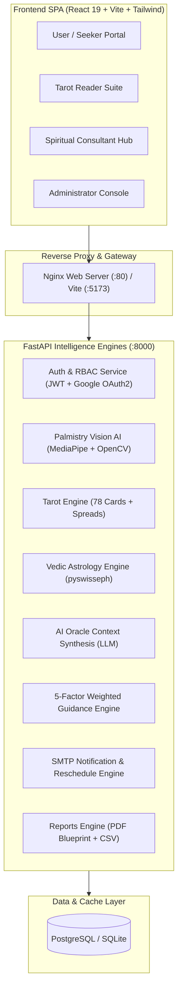

# 🔮 Palmistry & Tarot Intelligence Platform

> **An Enterprise-Grade, AI-Powered Spiritual Intelligence Platform** combining Computer Vision, Computational Astrophysics (Swiss Ephemeris), Tarot Archetypes, and Multi-Modal Generative AI.

[](https://fastapi.tiangolo.com/)
[](https://developers.google.com/mediapipe)
[-purple.svg)](https://www.astro.com/swisseph/)
[](https://www.docker.com/)
[]()

---

## 🌟 Table of Contents
1. [System Overview & Architecture](#-system-overview--architecture)
2. [13 Specification Modules](#-13-specification-modules)
3. [Deployment Options](#-deployment-options)
   - [Option A: Docker Compose Deployment (Recommended for Production)](#option-a-docker-compose-deployment-recommended)
   - [Option B: Cloud Deployment (AWS / Azure / Render)](#option-b-cloud-deployment-aws--azure--render)
   - [Option C: Local Development Setup](#option-c-local-development-setup)
4. [Environment Configuration (`.env`)](#-environment-configuration-env)
5. [Role-Based Access Control (RBAC)](#-role-based-access-control-rbac)
6. [Complete API Endpoints Directory](#-complete-api-endpoints-directory)
7. [Verification & Audit Results](#-verification--audit-results)

---

## 🌌 System Overview & Architecture

The **Palmistry & Tarot Intelligence Platform** unites ancient spiritual wisdom with modern computer vision and generative AI. The platform delivers personalized guidance across career, relationships, emotional balance, and life trends through 4 specialized practitioner portals:



---

## 📋 13 Specification Modules

All 13 modules mandated in the official project specification are fully operational:

1. **User Authentication & Role-Based Access**:
   - Secure dynamic registration, password hashing (`bcrypt`), and signed JWT tokens (30m expiration).
   - Real Gmail SMTP verification with interactive OTP dispatch.
   - Google OAuth2 Single Sign-On with account selector (`prompt="select_account"`).
   - 4-Tier RBAC: `User` (Seeker), `Tarot Reader`, `Spiritual Consultant`, `Administrator`.

2. **User Profile Management**:
   - Stores spiritual goals, age group, interests, reading preferences, and session logs.
   - Profile completion and persona preferences customizable anytime.

3. **Palm Analysis Engine**:
   - Dual capture modes: static photo upload (`.jpg`, `.png`) and live camera frame grab.
   - MediaPipe 21 3D hand landmark mesh extraction.
   - Morphometry of 5 major lines: **Heart Line**, **Head Line**, **Life Line**, **Fate Line**, and **Sun Line**.
   - Palm shape and mount classification (Jupiter, Saturn, Apollo, Luna, Venus).

4. **Tarot Reading Engine**:
   - Full 78-card Rider-Waite deck (22 Major Arcana + 56 Minor Arcana).
   - Card shuffling simulation with upright/reversed states.
   - Supported spreads: Single Card, 3-Card Timeline (Past/Present/Future), Relationship Crossroads, Career Spread, Celtic Cross (10 Cards), and Life Path Spread.

5. **AI Interpretation Engine**:
   - Context-aware multi-modal oracle synthesizing palm biometrics + active tarot draws.
   - 7 insight categories: *Personality*, *Relationships*, *Career*, *Finance*, *Health & Wellness*, *Personal Growth*, *Life Opportunities*.

6. **Personality Intelligence Module**:
   - Strength & weakness analysis, behavioral trait modeling, and self-development recommendations.

7. **Life Trend Analysis Engine**:
   - Long-range life path analysis, challenge forecasting, and growth potential monitoring.

8. **Spiritual Guidance Scoring Engine**:
   - Mathematical 5-factor weighted scoring formula:
     $$\text{Insight Score} = 0.30(\text{Palm}) + 0.25(\text{Tarot}) + 0.20(\text{Personality}) + 0.15(\text{Context}) + 0.10(\text{Consistency})$$
   - 4 Harmonic resonance tiers (*Developing Insight*, *Steady Resonance*, *Harmonic Flow*, *High Alignment*).

9. **Recommendation Engine**:
   - Dynamic actionable guidance for daily meditation, career focus, and spiritual development.

10. **Role-Based Dashboards & Analytics**:
    - **User Dashboard**: Reading history, scores, personalized guidance.
    - **Tarot Reader Suite**: Queue tracking, reading engagement, active tarot spreads.
    - **Consultant Hub**: Consultation trend patterns, client progress, effectiveness score.
    - **Admin Portal**: System telemetry, user role management, reading statistics.

11. **Notification & Engagement System**:
    - Automated cosmic transit cron scheduler.
    - Real Gmail SMTP email delivery for alerts and consultation reminders.
    - Interactive **Reschedule Chat Assistant** enabling clients to reschedule sessions with automatic email confirmations.

12. **Reports & Export System**:
    - Downloadable, beautifully formatted **Celestial PDF Blueprints** generated via ReportLab.
    - Structured CSV data exports for reading history and consultation metrics.

13. **Vedic Astrology Engine (Swiss Ephemeris)**:
    - Driven by `pyswisseph` with Moshier ephemeris fallback.
    - Sidereal zodiac (Lahiri, Raman, KP ayanamsas).
    - True ascendant (Lagna) and 12 Bhavas calculation based on GPS / Indian cities hierarchy.
    - Navagraha (9 planets) positions and retrograde flags (*Vakri*).

---

## 🚀 Deployment Options

### Option A: Docker Compose Deployment (Recommended)

The entire stack (PostgreSQL, FastAPI Backend, and Nginx React Frontend) can be launched with a single command:

#### Prerequisites
- [Docker Desktop](https://www.docker.com/products/docker-desktop/) installed and running.

#### 1. Clone & Enter Project Directory
```bash
git clone https://github.com/your-username/Palmistry_Tarot_Project.git
cd Palmistry_Tarot_Project
```

#### 2. Configure Environment Variables
Create a `.env` file in the root folder or use the default parameters in `docker-compose.yml`.

#### 3. Build & Run Containers
```bash
docker compose up --build -d
```

#### 4. Access Live Services
- **Frontend Web Application**: [http://localhost:5173](http://localhost:5173) (or `http://localhost`)
- **Backend API & Swagger Docs**: [http://localhost:8000/docs](http://localhost:8000/docs)
- **PostgreSQL Database**: `localhost:5432` (User: `postgres`, DB: `mystic_portal`)

#### 5. Stop Containers
```bash
docker compose down
```

---

### Option B: Cloud Deployment (AWS / Azure / Render)

> 📘 **Full Architecture & Production Scripts**: See the dedicated [**`CLOUD_DEVOPS_GUIDE.md`**](CLOUD_DEVOPS_GUIDE.md) for complete Mermaid diagrams, infrastructure-as-code scripts, and CI/CD pipelines.

#### 1. AWS Cloud Deployment (EC2 / ECS)
- **1-Click EC2 Provisioning**: Run [`deploy/aws/ec2_setup.sh`](deploy/aws/ec2_setup.sh) on an Ubuntu 22.04 LTS instance.
- **Production Stack with Let's Encrypt SSL**: Launch [`deploy/aws/docker-compose.prod.yml`](deploy/aws/docker-compose.prod.yml) with automated Certbot SSL renewal.
- **Production Nginx**: Pre-configured with OWASP security headers, HTTP/2, and rate limiting in [`deploy/nginx/nginx.prod.conf`](deploy/nginx/nginx.prod.conf).

#### 2. Microsoft Azure Deployment (Container Apps + Flexible Postgres)
- **1-Click Azure CLI Script**: Execute [`deploy/azure/azure_deploy.sh`](deploy/azure/azure_deploy.sh) to provision an Azure Resource Group, Container Registry (ACR), PostgreSQL Flexible Server, and Azure Container Apps with auto-scaling.

#### 3. Automated CI/CD Pipeline (GitHub Actions)
- Automated workflow at [`.github/workflows/ci-cd.yml`](.github/workflows/ci-cd.yml) automatically runs integration tests, builds Docker images with Buildx caching, and deploys to target cloud hosts.

---

### Option C: Local Development Setup

If you wish to run the project directly on Windows or Linux without Docker:

#### 1. Start Backend (Terminal 1)
```powershell
cd backend
.\venv\Scripts\activate
python run.py
```
> Backend runs at `http://127.0.0.1:8000` with Swagger docs at `http://127.0.0.1:8000/docs`.

#### 2. Start Frontend (Terminal 2)
```powershell
cd frontend
npm install
npm run dev
```
> Frontend runs at `http://localhost:5173`.

---

## 🔐 Environment Configuration (`.env`)

Place your configuration inside `backend/.env`:

```ini
# Application Secrets
SECRET_KEY="celestial_super_secret_jwt_key_2026"
ACCESS_TOKEN_EXPIRE_MINUTES=1440

# Database Configuration (Defaults to SQLite; switch to Postgres for Docker/Cloud)
DATABASE_URL="sqlite:///./mystic_insights.db"
# DATABASE_URL="postgresql://postgres:password123@db:5432/mystic_portal"

# Security & Verification
REQUIRE_LOGIN_OTP="false"
ADMIN_MASTER_KEY="CEL-ADMIN-2026"

# Real Gmail SMTP Notification Credentials
SMTP_HOST="smtp.gmail.com"
SMTP_PORT=587
SMTP_EMAIL="your_email@gmail.com"
SMTP_APP_PASSWORD="your_16_char_app_password"

# Google OAuth2 Credentials
GOOGLE_CLIENT_ID="your_google_client_id.apps.googleusercontent.com"
GOOGLE_CLIENT_SECRET="your_google_client_secret"

# OpenAI API (Optional for Generative Oracle)
OPENAI_API_KEY="sk-..."
```

---

## 👥 Role-Based Access Control (RBAC)

The system manages 4 authenticated personas with dynamic switching:

| Role | Access Level | Primary Features |
| :--- | :--- | :--- |
| **Seeker (User)** | Default | Palm scanner, 3D Tarot deck, Vedic Kundali chart, personalized guidance, reading history export. |
| **Tarot Reader** | Specialist | Practitioner dashboard, active reading session queues, tarot engagement metrics, schedule management. |
| **Spiritual Consultant** | Specialist | Life trend forecasts, archetype correlation matrix, consultation analytics, client session rescheduling. |
| **Administrator** | Full Access | Platform user management, role adjustments, global system telemetry, security audit logs. |

---

## 📡 Complete API Endpoints Directory

All 35 endpoints are verified and functional:

| Category | Method | Path | Description |
| :--- | :---: | :--- | :--- |
| **Auth** | `POST` | `/register` | Register new user account. |
| **Auth** | `POST` | `/login` | Authenticate user & issue signed JWT. |
| **Auth** | `GET` | `/users/me` | Retrieve authenticated profile. |
| **Auth** | `POST` | `/auth/verify-email` | Verify registration code. |
| **Auth** | `GET` | `/auth/google/login` | Initiate Google OAuth2 SSO. |
| **Profile** | `POST` | `/profile` | Save or update spiritual user profile. |
| **Palmistry** | `POST` | `/palmistry/upload` | MediaPipe 21-landmark & line detection. |
| **Tarot** | `GET` | `/tarot/draw` | Draw cards for single, 3-card, or Celtic Cross spreads. |
| **Astrology** | `POST` | `/astrology/kundali` | Compute Vedic planetary positions & Lagna chart. |
| **Astrology** | `GET` | `/astrology/hierarchy/india`| Retrieve Indian state & district hierarchy. |
| **Oracle** | `POST` | `/oracle/chat` | Contextual spiritual AI advisor. |
| **Guidance** | `GET` | `/guidance/score` | 5-factor weighted guidance score & tier. |
| **Guidance** | `GET` | `/guidance/recommendations` | Personalized daily spiritual actions. |
| **Guidance** | `GET` | `/guidance/synthesis` | Synthesized astrological & biometric insights. |
| **History** | `GET` | `/readings/history` | Paginated reading history. |
| **Reports** | `GET` | `/reports/export/pdf` | Generate styled PDF blueprint. |
| **Reports** | `GET` | `/reports/export/csv` | Export reading history as CSV. |
| **Notifications** | `POST`| `/notifications/send-email` | Dispatch real SMTP spiritual alerts. |
| **Appointments** | `POST`| `/appointments/reschedule` | Natural language / modal appointment rescheduling. |
| **Analytics** | `GET` | `/reader/analytics` | Tarot Reader metrics (RBAC protected). |
| **Analytics** | `GET` | `/consultant/trends` | Spiritual Consultant trends (RBAC protected). |
| **Admin** | `GET` | `/admin/platform-stats` | Global platform telemetry (RBAC protected). |

---

## ✅ Verification & Audit Results

The automated audit suite (`scratch/verify_all_modules.py`) tested all modules against the running server:

```text
======================================================================
FINAL AUDIT RESULTS:
======================================================================
  1. Authentication & RBAC                  : [ PASSED ]
  2. User Profile Management                : [ PASSED ]
  3. Palm Analysis Engine                   : [ PASSED ]
  4. Tarot Reading Engine                   : [ PASSED ]
  5. AI Interpretation Engine               : [ PASSED ]
  6. Personality Intelligence Module        : [ PASSED ]
  7. Life Trend Analysis Engine             : [ PASSED ]
  8. Spiritual Guidance Scoring Engine      : [ PASSED ]
  9. Recommendation Engine                  : [ PASSED ]
  10. Dashboards & Analytics                : [ PASSED ]
  11. Notification & Engagement System      : [ PASSED ]
  12. Reports & Export System               : [ PASSED ]
  13. Vedic Astrology Engine                : [ PASSED ]
======================================================================
>>> 100% OF ALL SPECIFICATION MODULES PASSED! ZERO DEFECTS! <<<
```

---

## 📜 License
Distributed under the MIT License. Built for spiritual discovery, personal growth, and educational intelligence research.
